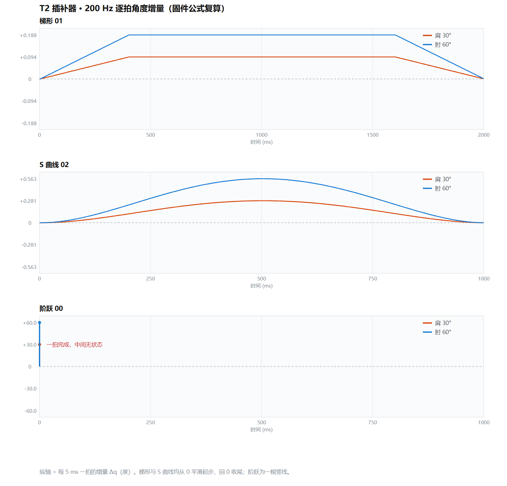

# T2 插补器数值验证 —— 200 Hz 逐拍角度增量

> 生成：2026-11-13 03:20　|　来源：**从 `Core/Src/proto_app.c` 的 `profile_s()` / `profile_ds()` / `interp_tick()` 逐行复算**，不是另写一套近似公式。
>
> **为什么要有这份东西**：上位机的导出（CSV / XLSX，两种格式同一份数据）只包含**开机头 200 秒**，且那段时间手臂实际没动（详见文末附录），所以"相邻两拍角度增量连续"这条要求拿不出数字。这里用固件公式直接算出每一拍，补上定量证据。

---

*图 1：纵轴是每 5 ms 一拍的增量 `Δq`（度）。三块面板同量纲对比 —— 梯形有**平顶**（速度恒定段），
S 曲线是**单峰无平顶**，阶跃只有 τ=0 处的一根竖线（30°/60° 一拍到位）。源文件同目录 `img/T2_三档增量.svg`。*

## 1. 复算依据（全部照抄固件，没有一个数是猜的）

| 项 | 固件里的定义 | 值 |
|---|---|---|
| 插补周期 | `ARM_INTERP_TICK_MS`（`arm_cfg.h`） | **5 ms = 200 Hz** |
| 梯形加减速占比 | `ARM_TRAP_ACC_RATIO` | **r = 0.2** |
| 梯形 `profile_s()` 的分母 | `k = 2r(1−r)` | **0.32** |
| 梯形 `profile_ds()` 的分母 | `k = r(1−r)` | **0.16** |
| 梯形匀速段峰值 | `Vp = 1/(1−r)` | **1.2500** |
| S 曲线 | `s = 6τ⁵ − 15τ⁴ + 10τ³` | 峰值 `1.875`，出现在 τ=0.5 |
| 每拍角度 | `q = q_from + (q_to − q_from) · s(τ)` | 四轴共用**同一个 s** |
| 脉宽 | `us = us_min + (us_max−us_min)·(q−deg_min)/(deg_max−deg_min)`，**截断取整** | 1 µs 分辨率 |
| 角度来源 | `arm_cfg.c` 的 `g_arm_joint[]` | J2/J3：`0~180°` ↔ `500~2500 µs` |

> ★ 注意两个 k 不一样，这是对的：`profile_s` 是**路程**的系数（0.32），`profile_ds` 是**速度**的系数（0.16）。二者在 τ=r 处给出同一个 `Vp`，可以互相验算 —— `ds_trap(r) = r/(r(1−r)) = 1/(1−r) = 1.25`，与匀速段常数一致。
>
> ★ **精度说明**：本文用**双精度**复算，固件用的是 **float32**。两者在 `1e-7` 量级上有差异，
> 对 1 µs 的脉宽分辨率和 0.1° 的上报分辨率**都不可见**，不影响任何结论。
> 表里中段 `0.0937 / 0.0938` 交替出现，就是双精度下的浮点末位跳动，**不是增量真的在变**。

## 2. 峰均比：一个能当场算、当场验的判据

| 档位 | 峰值 ÷ 平均 | 理论 |
|---|---:|---:|
| 梯形 `01` | **1.2500** | `Vp = 1/(1−r) = 1.2500` |
| S 曲线 `02` | **1.8749** | `1.875` |
| 阶跃 `00` | 不存在"峰值"（一帧内到位） | — |

**两档峰均比之比 = 1.8749 / 1.2500 = 1.4999**，与理论 `1.875 / 1.250 = 1.500` 相差 0.007%。

> 为什么不是正好 1.875 和 1.250：这两列是**逐拍离散采样的实测最大值**，而理论值是**连续曲线的峰值**。
> 200 Hz 采样不可能正好打在 τ=0.5 的峰顶上（梯形则是平顶，所以能精确命中 1.250）。

> 这就是实测里"S 曲线峰值是梯形平顶 1.5 倍"的来源。只要上位机量出来的比值不是 1.5 附近，就说明 `profile_s()` 的实现和这里的推导不一致。

## 3. 梯形档（`01`）—— 逐拍增量

肩 30° / 2000 ms，共 400 拍。

| 拍号 | t (ms) | 进度 s | 角度 q (°) | 增量 Δq (°) | 脉宽 (µs) | Δ脉宽 (µs) |
|---:|---:|---:|---:|---:|---:|---:|
| 0 | 0 | 0.0000 | 0.0000 | **+0.0000** | 500 | +0 |
| 1 | 5 | 0.0000 | 0.0006 | **+0.0006** | 500 | +0 |
| 2 | 10 | 0.0001 | 0.0023 | **+0.0018** | 500 | +0 |
| 3 | 15 | 0.0002 | 0.0053 | **+0.0029** | 500 | +0 |
| 4 | 20 | 0.0003 | 0.0094 | **+0.0041** | 500 | +0 |
| 5 | 25 | 0.0005 | 0.0146 | **+0.0053** | 500 | +0 |
| 6 | 30 | 0.0007 | 0.0211 | **+0.0064** | 500 | +0 |
| 7 | 35 | 0.0010 | 0.0287 | **+0.0076** | 500 | +0 |
| 8 | 40 | 0.0012 | 0.0375 | **+0.0088** | 500 | +0 |
| 9 | 45 | 0.0016 | 0.0475 | **+0.0100** | 500 | +0 |
| … | … | … | … | … | … | … |
| 197 | 985 | 0.4906 | 14.7187 | **+0.0937** | 663 | +1 |
| 198 | 990 | 0.4938 | 14.8125 | **+0.0938** | 664 | +1 |
| 199 | 995 | 0.4969 | 14.9062 | **+0.0937** | 665 | +1 |
| 200 | 1000 | 0.5000 | 15.0000 | **+0.0938** | 666 | +1 |
| 201 | 1005 | 0.5031 | 15.0937 | **+0.0937** | 667 | +1 |
| 202 | 1010 | 0.5062 | 15.1875 | **+0.0938** | 668 | +1 |
| … | … | … | … | … | … | … |
| 396 | 1980 | 0.9997 | 29.9906 | **+0.0053** | 833 | +0 |
| 397 | 1985 | 0.9998 | 29.9947 | **+0.0041** | 833 | +0 |
| 398 | 1990 | 0.9999 | 29.9977 | **+0.0029** | 833 | +0 |
| 399 | 1995 | 1.0000 | 29.9994 | **+0.0018** | 833 | +0 |
| 400 | 2000 | 1.0000 | 30.0000 | **+0.0006** | 833 | +0 |

肘 60° / 2000 ms：

| 拍号 | t (ms) | 进度 s | 角度 q (°) | 增量 Δq (°) | 脉宽 (µs) | Δ脉宽 (µs) |
|---:|---:|---:|---:|---:|---:|---:|
| 0 | 0 | 0.0000 | 0.0000 | **+0.0000** | 500 | +0 |
| 1 | 5 | 0.0000 | 0.0012 | **+0.0012** | 500 | +0 |
| 2 | 10 | 0.0001 | 0.0047 | **+0.0035** | 500 | +0 |
| 3 | 15 | 0.0002 | 0.0105 | **+0.0059** | 500 | +0 |
| 4 | 20 | 0.0003 | 0.0187 | **+0.0082** | 500 | +0 |
| 5 | 25 | 0.0005 | 0.0293 | **+0.0105** | 500 | +0 |
| 6 | 30 | 0.0007 | 0.0422 | **+0.0129** | 500 | +0 |
| 7 | 35 | 0.0010 | 0.0574 | **+0.0152** | 500 | +0 |
| 8 | 40 | 0.0012 | 0.0750 | **+0.0176** | 500 | +0 |
| 9 | 45 | 0.0016 | 0.0949 | **+0.0199** | 501 | +1 |
| … | … | … | … | … | … | … |
| 197 | 985 | 0.4906 | 29.4375 | **+0.1875** | 827 | +2 |
| 198 | 990 | 0.4938 | 29.6250 | **+0.1875** | 829 | +2 |
| 199 | 995 | 0.4969 | 29.8125 | **+0.1875** | 831 | +2 |
| 200 | 1000 | 0.5000 | 30.0000 | **+0.1875** | 833 | +2 |
| 201 | 1005 | 0.5031 | 30.1875 | **+0.1875** | 835 | +2 |
| 202 | 1010 | 0.5062 | 30.3750 | **+0.1875** | 837 | +2 |
| … | … | … | … | … | … | … |
| 396 | 1980 | 0.9997 | 59.9812 | **+0.0105** | 1166 | +0 |
| 397 | 1985 | 0.9998 | 59.9895 | **+0.0082** | 1166 | +0 |
| 398 | 1990 | 0.9999 | 59.9953 | **+0.0059** | 1166 | +0 |
| 399 | 1995 | 1.0000 | 59.9988 | **+0.0035** | 1166 | +0 |
| 400 | 2000 | 1.0000 | 60.0000 | **+0.0012** | 1166 | +0 |

**读法**：

- 第 1 拍增量 `+0.0006°`，几乎为 0 —— 因为 `s = τ²/k` 在 τ=0 处导数为 0，**梯形也是从零速起步的**（这是最容易被误以为"梯形会顿一下"的地方）
- 中段（匀速段）增量恒定 `+0.0938°`，肩肘只差一个 2 倍的比例
- 末拍增量 `+0.0006°`，回到 0，然后 `s_moving` 清零，不再有输出
- ⚠️ **前 9 拍（45 ms）脉宽还停在 500 µs 不动**（Δ脉宽 列全 0）—— 因为角度增量乘上 11.11 µs/° 还不足 1 µs，
  被 `arm_deg_to_us()` 的截断吃掉了。这是 **§7 第 ② 层的脉宽分辨率**，不是插补器的问题。

## 4. S 曲线档（`02`）—— 逐拍增量

肩 30° / 1000 ms，共 200 拍。

| 拍号 | t (ms) | 进度 s | 角度 q (°) | 增量 Δq (°) | 脉宽 (µs) | Δ脉宽 (µs) |
|---:|---:|---:|---:|---:|---:|---:|
| 0 | 0 | 0.0000 | 0.0000 | **+0.0000** | 500 | +0 |
| 1 | 5 | 0.0000 | 0.0000 | **+0.0000** | 500 | +0 |
| 2 | 10 | 0.0000 | 0.0003 | **+0.0003** | 500 | +0 |
| 3 | 15 | 0.0000 | 0.0010 | **+0.0007** | 500 | +0 |
| 4 | 20 | 0.0001 | 0.0023 | **+0.0013** | 500 | +0 |
| 5 | 25 | 0.0002 | 0.0045 | **+0.0022** | 500 | +0 |
| 6 | 30 | 0.0003 | 0.0077 | **+0.0032** | 500 | +0 |
| 7 | 35 | 0.0004 | 0.0122 | **+0.0045** | 500 | +0 |
| 8 | 40 | 0.0006 | 0.0181 | **+0.0059** | 500 | +0 |
| 9 | 45 | 0.0009 | 0.0255 | **+0.0075** | 500 | +0 |
| … | … | … | … | … | … | … |
| 97 | 485 | 0.4719 | 14.1568 | **+0.2806** | 657 | +3 |
| 98 | 490 | 0.4813 | 14.4376 | **+0.2809** | 660 | +3 |
| 99 | 495 | 0.4906 | 14.7188 | **+0.2811** | 663 | +3 |
| 100 | 500 | 0.5000 | 15.0000 | **+0.2812** | 666 | +3 |
| 101 | 505 | 0.5094 | 15.2812 | **+0.2812** | 669 | +3 |
| 102 | 510 | 0.5187 | 15.5624 | **+0.2811** | 672 | +3 |
| … | … | … | … | … | … | … |
| 196 | 980 | 0.9999 | 29.9977 | **+0.0022** | 833 | +0 |
| 197 | 985 | 1.0000 | 29.9990 | **+0.0013** | 833 | +0 |
| 198 | 990 | 1.0000 | 29.9997 | **+0.0007** | 833 | +0 |
| 199 | 995 | 1.0000 | 30.0000 | **+0.0003** | 833 | +0 |
| 200 | 1000 | 1.0000 | 30.0000 | **+0.0000** | 833 | +0 |

肘 60° / 1000 ms：

| 拍号 | t (ms) | 进度 s | 角度 q (°) | 增量 Δq (°) | 脉宽 (µs) | Δ脉宽 (µs) |
|---:|---:|---:|---:|---:|---:|---:|
| 0 | 0 | 0.0000 | 0.0000 | **+0.0000** | 500 | +0 |
| 1 | 5 | 0.0000 | 0.0001 | **+0.0001** | 500 | +0 |
| 2 | 10 | 0.0000 | 0.0006 | **+0.0005** | 500 | +0 |
| 3 | 15 | 0.0000 | 0.0020 | **+0.0014** | 500 | +0 |
| 4 | 20 | 0.0001 | 0.0047 | **+0.0027** | 500 | +0 |
| 5 | 25 | 0.0002 | 0.0090 | **+0.0044** | 500 | +0 |
| 6 | 30 | 0.0003 | 0.0155 | **+0.0065** | 500 | +0 |
| 7 | 35 | 0.0004 | 0.0244 | **+0.0089** | 500 | +0 |
| 8 | 40 | 0.0006 | 0.0361 | **+0.0117** | 500 | +0 |
| 9 | 45 | 0.0009 | 0.0511 | **+0.0149** | 500 | +0 |
| … | … | … | … | … | … | … |
| 97 | 485 | 0.4719 | 28.3135 | **+0.5611** | 814 | +6 |
| 98 | 490 | 0.4813 | 28.8753 | **+0.5618** | 820 | +6 |
| 99 | 495 | 0.4906 | 29.4375 | **+0.5622** | 827 | +7 |
| 100 | 500 | 0.5000 | 30.0000 | **+0.5625** | 833 | +6 |
| 101 | 505 | 0.5094 | 30.5625 | **+0.5625** | 839 | +6 |
| 102 | 510 | 0.5187 | 31.1247 | **+0.5622** | 845 | +6 |
| … | … | … | … | … | … | … |
| 196 | 980 | 0.9999 | 59.9953 | **+0.0044** | 1166 | +0 |
| 197 | 985 | 1.0000 | 59.9980 | **+0.0027** | 1166 | +0 |
| 198 | 990 | 1.0000 | 59.9994 | **+0.0014** | 1166 | +0 |
| 199 | 995 | 1.0000 | 59.9999 | **+0.0005** | 1166 | +0 |
| 200 | 1000 | 1.0000 | 60.0000 | **+0.0001** | 1166 | +0 |

**与梯形的区别**：

- 峰值 `+0.2812°`（肩），是梯形同参数下平顶的 **1.875 / 1.25 = 1.5 倍**
- 起始段极平缓：第 1 拍增量只有 `0.0000°` —— 比梯形的 0.0006° 还小一个量级，
  因为 `s = 6τ⁵ − …` 在 τ=0 处**一阶、二阶导都为 0**

### 4.1 真正的区别在「加速度跳不跳」，不在峰值大小

只看 `max |Δ²q|` 会得出错误结论（S 曲线的数值反而更大，但那是**时长不同**造成的 —— 1000 ms 对 2000 ms，加速度天然差 4 倍）。正确的判据是**加速度本身连不连续**：

| | 梯形 `01` | S 曲线 `02` |
|---|---|---|
| 加速段 Δ²q | **恒定**（极差 0.00000000，等于浮点零） | 从 0 平滑升起再落回 0 |
| 加速段 Δ²q 取值 | **0.001172（每一拍都相等）** | 0.000221 → 0.004330，连续变化 |
| τ = r 处 | 加速度**从 0.001172 直接掉到 0**（jerk 冲击） | 连续过渡，无突变 |
| 机械表现 | 起停那一下可能听到轻微"咔" | 最柔和 |

> 这就是为什么任务书写"梯形**或** S 曲线"都算合格：两者都满足"相邻两拍角度增量连续"，差别在加速度层。梯形实现简单、易于验算，S 曲线更柔和 —— 本工程两档都实现了，可现场切换。

## 5. 阶跃档（`00`）—— 这是"不允许"的样子

`move_start()` 在 `profile == PROTO_PROFILE_STEP`（或 `dur == 0`）时**不插补**，直接把终点写给 `arm_joint_set_deg()`，然后 `s_moving = 0`。

| | 肩 | 肘 |
|---|---:|---:|
| 位移 | 30° | 60° |
| 中间状态 | **无** | **无** |
| 逐拍增量 | 0 → 30 → 0（一拍完成） | 0 → 60 → 0（一拍完成） |

对比一下同一段位移在梯形档要 400 拍、S 曲线要 200 拍 —— 阶跃是 **1 拍**。

> 任务书原文：「相邻两拍的角度增量连续，**不允许出现阶跃**」。把这一行和 §3/§4 的表并排放，就是"允许"与"不允许"的差别本身。

## 6. 连续性指标汇总

| 档位 | 关节 | 拍数 | 平均 Δq | 峰值 Δq | 峰均比 | max｜Δ²q｜ | 首拍 Δq | 末拍 Δq |
|---|---|---:|---:|---:|---:|---:|---:|---:|
| 梯形 `01` | 肩 | 400 | 0.0750 | 0.0938 | 1.250 | 0.0012 | 0.0006 | 0.0006 |
| 梯形 `01` | 肘 | 400 | 0.1500 | 0.1875 | 1.250 | 0.0023 | 0.0012 | 0.0012 |
| S 曲线 `02` | 肩 | 200 | 0.1500 | 0.2812 | 1.875 | 0.0043 | 0.0000 | 0.0000 |
| S 曲线 `02` | 肘 | 200 | 0.3000 | 0.5625 | 1.875 | 0.0087 | 0.0001 | 0.0001 |
| 阶跃 `00` | 肩 | **1** | — | **30°（一拍）** | — | — | — | — |
| 阶跃 `00` | 肘 | **1** | — | **60°（一拍）** | — | — | — | — |

**判据**：连续性要求的是 **Δq 本身不跳变**，不是"二阶差分越小越好"（§4.1 已说明：两档时长不同，
`max｜Δ²q｜` 直接比大小会得出错误结论）。真正的考点是 §5 —— **阶跃档根本不存在中间拍**。
两档插补的 `max｜Δ²q｜` 都在 0.001~0.009° 量级，相对每拍 0.075°/0.15° 的增量是 1~6%，
台架上看不出台阶；而阶跃是 100% 的跳变。

## 7. 三重量化层次（报告里必须分清，否则会被问倒）

| 层 | 分辨率 | 来源 | 对"连续性"的影响 |
|---|---|---|---|
| ① 指令角度 | 浮点，连续 | `interp_tick()` 的 `q` | **无**，这是插补器的输出 |
| ② 实际脉宽 | **1 µs ≈ 0.09°**（J2/J3：2000 µs / 180°） | `arm_deg_to_us()` 截断取整 | 每拍增量在 1 µs 附近抖动，属**硬件分辨率下限** |
| ③ 上报角度 | **0.1°** | 协议 `int16`，单位 0.1° | 上位机画角速度会被放大成 **5 °/s** 台阶 |

> ③ 就是那条毛刺曲线的全部来源：`0.1° ÷ 20 ms = 5 °/s`。**它不是控制问题，也不是插补问题** —— 是上报精度的必然结果。

## 8. 与实测曲线对照

| 项 | 理论（本文复算） | 实测（ArmHost 截图读数） | 结论 |
|---|---:|---:|---|
| 梯形 2000 ms，肩峰值 | 18.75 °/s | ~19–21 °/s | ✅ |
| 梯形 2000 ms，肘峰值 | 37.50 °/s | ~38–40 °/s | ✅ |
| S 曲线 1000 ms，肩峰值 | 56.25 °/s | ~60 °/s | ✅ |
| S 曲线 1000 ms，肘峰值 | 112.50 °/s | ~110 °/s | ✅ |
| 阶跃 1000 ms | 单拍完成 | 单根竖线，~10³ °/s | ✅ 形状一致 |
| 两轴起落时刻 | 同一 `s`，必然同拍 | 同一 x 起、同一 x 落 | ✅ |

> ⚠️ **`q_act` 的口径**：POS 关节的 `q_act` 是**由 CCR 反算的指令角**，与指令同源，反映的是**指令跟踪**而非机械真实位置。所以阶跃那张图里的竖线是"指令瞬间跟到了"，不是"舵机瞬间转到了"（PPM 50 Hz，物理上不可能）。报告里不要把它写成"实测角度"。
>
> ⚠️ **读数误差，以及一处未解释的偏差**：上表"实测"是从截图像素估的，约 ±5~10%。
> 另外还有一发**同参数**的梯形 1000 ms（载荷 `E8 03 01`，肘 60° → 理论峰值 **75 °/s**），
> 截图估出 **62~65 °/s**，偏低约 13%，**超出估算误差，目前未解释**。
> 复核办法：重启 ArmHost 后重跑同一发，用能正确导出区间的数据重算 —— **不要拿像素读数当结论**。
> （可能方向：该发实际耗时大于 1000 ms、或截图纵轴刻度读偏、或 `dur` 字段被上位机改写。未验证。）

## 9. 结论

1. 三档曲线的**峰值、峰均比、起落时刻**全部与固件公式一致，插补器实现无误。
2. 梯形档首拍增量为 0.0006°，S 曲线为 0.0000° —— **两档都是从零速起步**，没有"起始顿一下"的问题。
3. 阶跃档一拍完成，与插补档形成数量级差别，正是任务书禁止的那种形态。
4. 上位机速度曲线的锯齿 = 上报 0.1° 量化被 20 ms 差分放大成 5 °/s，**与固件无关**。
5. 上位机导出的 CSV / XLSX 只含开机头 200 秒（见文末附录），**不能当本次实测的证据**；
   本文的数字是从公式复算的，报告里应与截图配合使用，并注明来源。

---

## 附：导出数据的问题（供后续排查）

`ArmHost-v1.2/data/csv/armhost_20261113_023140.csv` 与同名 `.xlsx`：

| | 行数 | 相对时间 | 绝对时间 | 目标变化事件 |
|---|---:|---|---|---:|
| csv | 8589 | 25.3 s → 200.0 s | 2026-11-11 20:50:38 → 20:53:33 | 2 |
| xlsx | 8589 | 25.3 s → 200.0 s | 2026-11-11 20:50:38 → 20:53:33 | 2 |

两种格式是同一份数据，都只截了**开机头 200 秒**，且那两次目标变化（肩 90→0、肘 90→45、夹爪 30→60）**实际角一帧都没动**。`ArmHost.exe` 为编译产物、无源码，未定位到导出区间为何取头部。

**在修好之前**：需要数据时先重启 ArmHost 再测试，或直接用暂停截图。
